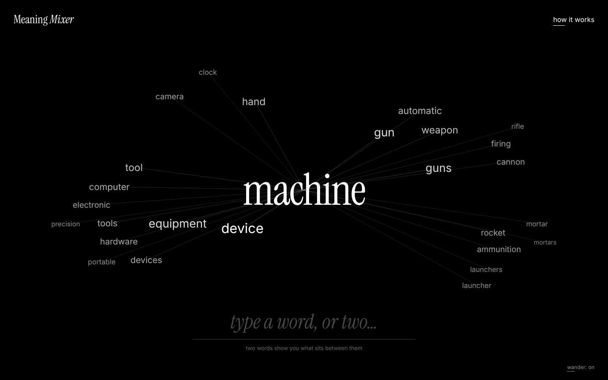

# Meaning Mixer

Explore 30,000 word embeddings in the browser. Type two words, see what sits between them.

**[Live demo](https://meaningmixer.netlify.app/)** · [Source](https://github.com/Aaryan0604/meaning-mixer) · Built by [Aaryan Gupta](https://github.com/Aaryan0604)

Type a word and its meaning-neighbours orbit it. Type two and see the words that sit between them.
Real word embeddings, running entirely in your browser: 30,000 words x 100 dimensions, shipped as 3 MB of static files.
No server, no API, nothing you type leaves the tab.

## Run
    npm install --ignore-scripts
    npm run dev        # http://localhost:5173
    npm run build      # output in dist/

## Deploy
Every push to `main` builds and publishes to GitHub Pages through `.github/workflows/pages.yml`. In the repo, open Settings, then Pages, and set Source to GitHub Actions (the publish script does this for you).

## How it works
- Data: `public/data/` holds the vocabulary, int8-quantised unit vectors and a per-word "hub" score. They were derived from the
  `wink-embeddings-sg-100d` skip-gram embeddings (see "Rebuilding the data").
- One word: brute-force cosine similarity over 30k vectors (a few ms), take the top 26, flatten to 2D with PCA
  (power iteration on the Gram matrix) so related words stay near each other. Distance from centre = dissimilarity.
- Two words: rank every word by min(sim to A, sim to B), minus a hub penalty, so results are close to BOTH.
  Position along the line = which end a word leans toward; the perpendicular axis is the main remaining variation (PCA of the residuals).
- Hub penalty: generic words are loosely similar to everything. A word's hub score is its mean similarity to random words,
  and a curated list of function words / directions / generic verbs is pinned to maximum so they never appear as neighbours.
- Layout: label boxes are relaxed apart, and if two still collide the less relevant one is dropped, so text never overlaps.
- Wander mode hops between neighbours on its own until you interact.

## Rebuilding the data (optional)
The generator script is `build_data.js` (kept alongside the source in `tools/`). It needs `npm i wink-embeddings-sg-100d` (~110 MB) and writes
words.txt, vectors.i8, hub.u8, meta.json.

## Stack
React 19, TypeScript, Vite, Tailwind 4, anime.js v4 (entrances, SVG line drawing, float, input shake),
React Bits (TargetCursor, BlurText, ShinyText; see src/components/reactbits/LICENSE.md), self-hosted Instrument Serif + Inter.

## Interview talking points (in your own words)
- What an embedding is, and why cosine similarity works on it.
- Why PCA for display, and why that is lossy (100 dimensions -> 2).
- The hub problem: why nearest neighbours are polluted by generic words and how a penalty fixes it.
- Why "between two words" is min-similarity, not the average vector (the average is dominated by one word).
- Bias: the model learned from news text and reflects it. I say so in the UI.
- Engineering: shipping 3 MB of int8 instead of a 300 MB model; overlap-free layout.

## Licence
MIT for my code. Bundled third-party components keep their own licences.
